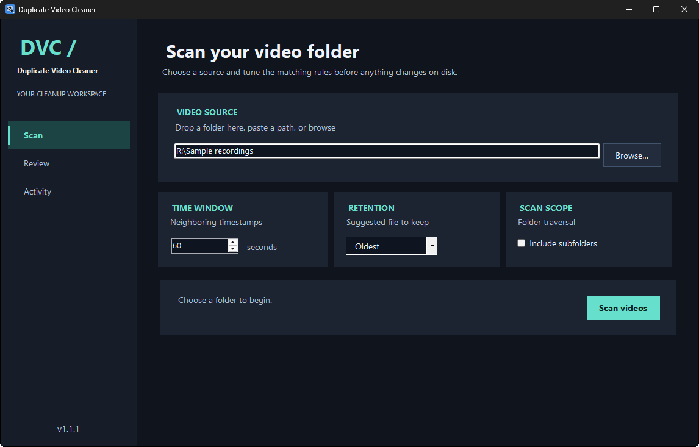
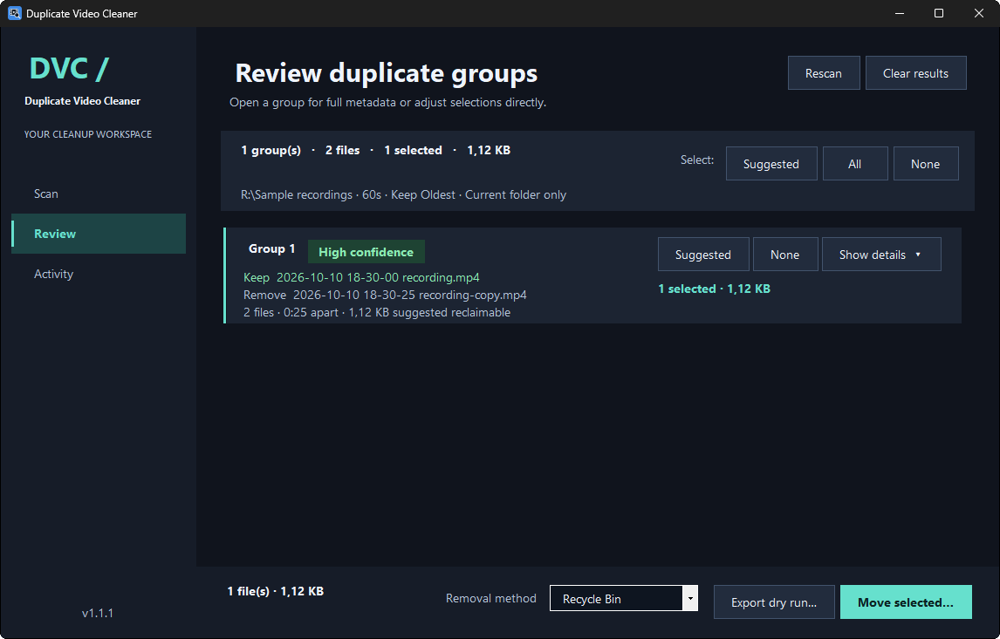
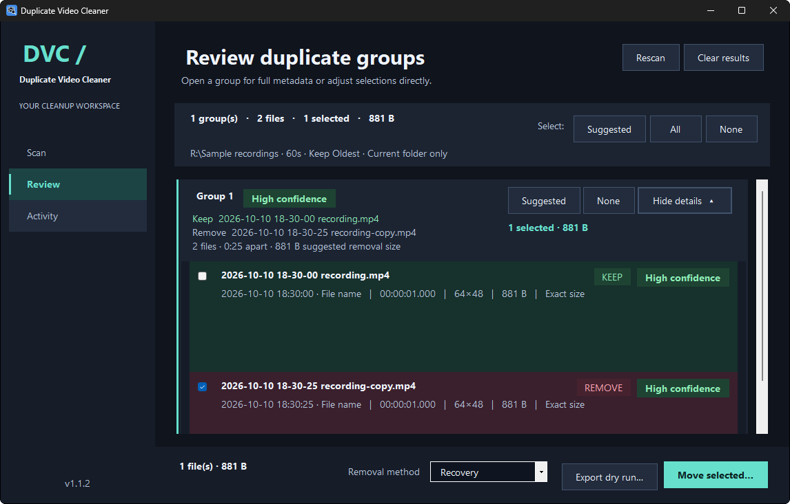
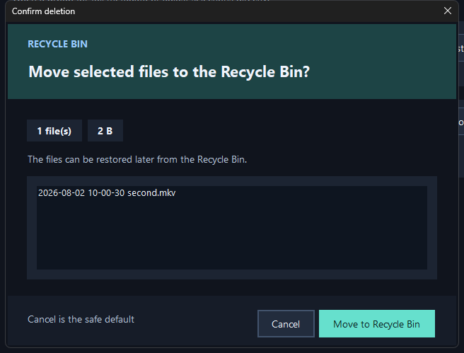
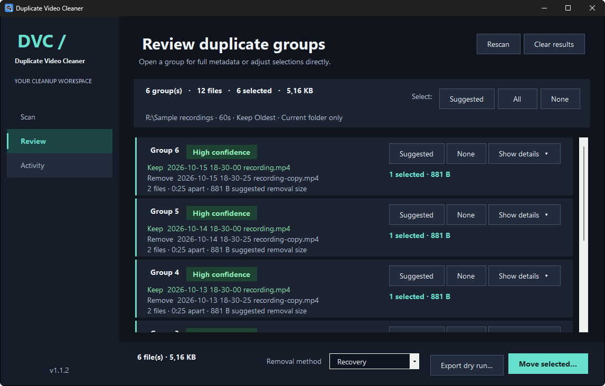
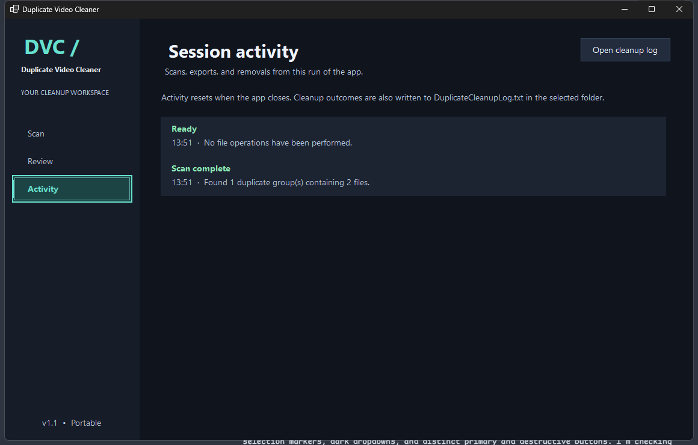

# Duplicate Video Cleaner

Find videos recorded close together, review the suggestions, and choose what to remove.

Duplicate Video Cleaner groups `.mp4` and `.mkv` files by their timestamps and protects clips without recording dates in their names. Duration, resolution, and file size help you compare each group and identify potential copies of protected clips. It does **not** compare video content, so a suggested duplicate may be a different recording. Review each selection before removing it.



## Download

Windows x64. The published 1.1.1 setup includes .NET and ffprobe. Version 1.1.2 is a local candidate pending release qualification; the source behavior below describes that candidate.

| Download | How to use it |
| --- | --- |
| [Setup EXE](https://github.com/Softhe/Duplicate-Video-Cleaner/releases/download/v1.1.1/DuplicateVideoCleaner-1.1.1-win-x64-setup.exe) | Run setup, then open the app from the Start menu. Installs for your Windows account without administrator rights. |

[Download checksums](https://github.com/Softhe/Duplicate-Video-Cleaner/releases/download/v1.1.1/SHA256SUMS.txt) · [Release notes](https://github.com/Softhe/Duplicate-Video-Cleaner/releases/tag/v1.1.1)

The published setup is unsigned. Preferences are saved in your Windows user profile. Uninstall through Windows Installed apps. Recovery media stays with its source folder and is not removed by uninstall.

## Review your videos

1. In **Scan**, choose a folder, set the time window, and choose whether to keep the oldest or newest file. Include subfolders if needed, then press **Scan videos**.
2. In **Review**, expand each group and compare its files. Check paths, timestamps, duration, resolution, and size. Use **Suggested**, **All**, or **None** to change the selection.
3. Use **Export dry run** to save CSV and text reports before making changes.
4. Choose the removal method, press **Move selected**, and review the confirmation. Recovery is the default; permanent deletion is also available. The confirmation defaults to Cancel.



<details>
<summary>See group details and the confirmation dialog</summary>





</details>

## What the suggestions mean

The app first looks for a timestamp in the filename, such as `2026-10-15 14-30-00.mp4`. If it cannot find a valid timestamp, it uses the earlier of the file's creation and modification times. This avoids grouping unrelated clips by a new creation time after a copy or cross-volume move when the original modification time survives. Review shows which timestamp source was used. Filesystem dates can also change during editing or transfers, so they do not prove when a video was recorded. It sorts the files and groups neighboring timestamps within your chosen window, which defaults to 60 seconds.

Groups can span longer than that window. With a 60-second window, recordings at 12:00:00, 12:00:50, and 12:01:40 belong to the same group because each neighboring pair is within 60 seconds.

Files without a valid recording date in the filename are treated as renamed clips and protected from removal. Windows does not provide a reliable rename history, so this rule also protects files that never had a date in their names. A renamed file that still contains a valid recording date is treated as an original-name clip.

Protected clips remain available for duplicate comparison. The scanner also considers original-name files with the same byte size as a protected clip, even outside the time window. This can join time groups and increase their displayed time span. Groups containing only protected clips are skipped. In a group with protected clips, an original-name file is eligible for removal only when its duration, resolution, and exact byte size match any protected clip. Duration is compared to the nearest millisecond. Missing or invalid metadata leaves the file unselected and blocks removal selection. All protected clips are kept, and the oldest/newest preference chooses the displayed keeper among them.

Review marks renamed clips as **PROTECTED**, disables their removal checkboxes, and names the protected clip establishing each metadata match. **Suggested** selects eligible originals; **All** also respects protection and the metadata requirement. Dry-run exports include each file's retention reason and the protected match path. Metadata matches are advisory and do not verify identical video content. Groups without protected clips continue to use the timestamp suggestions described above.

Before removing an eligible original, the app validates a matching protected clip against its scan snapshot and holds that clip and its parent directories open through removal. If that match is missing or changed, the app tries another matching protected clip. If none remains unchanged and available, the original is kept and the failure asks for a rescan. Other independent removals can continue.

Confidence compares ordinary files with the suggested keeper. Eligible copies of protected clips are compared with their actual named protected match, which can differ from the group's displayed keeper. The group badge shows the weakest suggested removal's confidence, excluding keeper self-comparisons. Groups without removal suggestions display **No removal suggested**.

| Confidence | Comparison |
| --- | --- |
| High | Duration, resolution, and byte size match. |
| Medium | Two of those three match. |
| Low | One or none match, or metadata is missing. |

Confidence is advisory. Even a High match does not establish that two files contain the same video.

<details>
<summary>See a review with several groups</summary>



</details>

## Safety and activity

Before removing a file, the app checks its size, creation time, last-write time, and Windows file identity against the scan. Changed files, missing scan snapshots, and symbolic links or reparse points are rejected. Both removal modes validate the same open file object and reject active writers. Recovery performs a same-volume move into .DuplicateVideoCleaner-Recovery beside each source file, with a durable record of its original location. Open Activity > Recovery to restore files without overwriting existing paths, or permanently delete them. Recovery does not free storage until permanent deletion. Keep recovery folders at their original locations.

Metadata probes run in a zero-capability Windows AppContainer with a one-process job, memory and CPU limits, bounded output, and a timeout. The broker stages a private media copy; original media ACLs are unchanged. Sandbox setup failures stop metadata probing without an unrestricted fallback. Temporary disk space is required, and copying large media increases scan time. CSV exports neutralize formula prefixes before spreadsheet programs open them.

Removal intent and outcome are recorded for each file in `DuplicateCleanupLog.txt` in the scanned folder. If the audit log cannot be written, the app stops further removals and keeps the results of completed removals accurate. After removal, the remaining groups recompute their suggested keeper and confidence.

Results retain the folder and rules used for the scan. Editing the Scan controls does not redirect cleanup logs or change an existing dry-run report's settings. Each export gets distinct filenames. Canceling a scan discards its partial result and stops active metadata probes.

Metadata is validated against the original scan snapshot before probing or using cached results. Changed files require a rescan. Fully cached batches skip sandbox setup and media copying. Media copies run one at a time to coordinate temporary disk usage; up to two parser processes can run concurrently. Scan shows copied bytes, processed files and elapsed time. Activity records enumeration, setup, copying, parsing and cache measurements. Copying has a separate 30-minute deadline per file, including time waiting for the copy slot; the 15-second parser deadline starts afterward. Individual blocked filesystem calls may delay cancellation. Cleanup problems appear in Activity while successful metadata remains available.

Scan diagnostics, report writes and queued preference saves run in the background. Pending preference snapshots coalesce, and closing waits asynchronously for the latest save. Cancel export keeps any completed reports and removes incomplete temporary files. Closing Recovery during discovery requests cancellation; restore and permanent deletion finish before the dialog can close. Individual filesystem calls on slow storage may take time to return before cancellation completes. Recovery rows are created on demand. **Archive completed history** moves verified completed records older than 30 days into `.completed-history` after confirmation. It deletes neither metadata nor media. Incomplete, active, unreadable and unexpected entries stay in place. Normal discovery skips archived history; **Inspect archived payloads** explicitly searches for unexpected archived media.

Startup checks for abandoned metadata staging at least 24 hours old. Only marked directories owned by the current Windows account, with no live owner or marker lease, qualify. Directory names, AppContainer profile names and ownership markers must agree. Unmarked, malformed, recent, contested and linked locations remain untouched. Cleanup warnings appear in Activity. The app does not broadly delete temporary folders or unrelated AppContainer profiles.

The **Activity** workspace shows session events, including scan entries that could not be read.



<details>
<summary>Build and test from source</summary>

You need the .NET 10 SDK on Windows. The SDK version and patch roll-forward policy are in `global.json`. Release packaging also requires PowerShell 7 and Inno Setup 6.

```powershell
dotnet run --project DuplicateVideoCleaner.Tests/DuplicateVideoCleaner.Tests.csproj -c Release
dotnet test DuplicateVideoCleaner.UiTests/DuplicateVideoCleaner.UiTests.csproj -c Release
./build/BuildRelease.ps1
```

`BuildRelease.ps1` runs the tests, publishes the self-contained app, verifies FFmpeg, and builds the setup EXE. Outputs are under `release`; `release/SHA256SUMS.txt` covers the setup EXE. Use `-Force` to replace generated outputs, or `-InnoSetupCompiler <path>` if `ISCC.exe` is not on PATH. The payload directory is intermediate build output.

The reviewed FFmpeg version, dated asset, expected SHA256, source revision, and build-system revision are in `build/FFmpeg.json`. Downloads and cached archives must match the expected hash before extraction. Upstream may retire dated assets; retain the verified cache for rebuilds. An unavailable or changed asset stops the build.

```powershell
./build/Test-BuildScripts.ps1 -VerifyDependency
./build/Test-InstalledSetup.ps1 -SetupPath ./release/DuplicateVideoCleaner-1.1.2-win-x64-setup.exe -PreviousSetupPath C:/path/to/1.1.1-setup.exe -RequireVirtualMachine -RunUiTests -EvidencePath ./release/installer-acceptance.json
```

The setup check refuses to run if this app is already installed. It uses a temporary install directory and isolated preferences, verifies the payload and bundled ffprobe, launches the app, and checks uninstall cleanup. Acceptance preserves its evidence. Public release requires VM acceptance of the exact setup checksum, upgrade, preferences, installed UI, and uninstall.

Qualification also launches the previous installed application to save non-default settings before upgrading. It independently checks that both applications rewrite the settings fixture and that the expected values remain intact. It checks installed versions and requires the exact candidate app to scan the synthetic video fixture with its bundled ffprobe inside the production sandbox, show duration/resolution and High advisory confidence, and export CSV and text through the UI. The installed-video test requires `DVC_TEST_APP_PATH`; normal source-only test runs report it as skipped. Release qualification supplies that path and requires a fresh success record. Pull requests run the release validation workflow without publishing. CI retains qualification logs, test results and acceptance records separately from the public setup EXE and checksum.

To test real video metadata through the UI, use a valid MP4 fixture. Run this in a separate PowerShell session so test overrides end with that session:

```powershell
$env:DVC_TEST_FFPROBE = (Resolve-Path release/DuplicateVideoCleaner-1.1.2-win-x64-payload/tools/ffprobe.exe).Path
$env:DVC_TEST_MEDIA = (Resolve-Path C:/path/to/sample.mp4).Path
dotnet test DuplicateVideoCleaner.UiTests/DuplicateVideoCleaner.UiTests.csproj -c Release --filter MetadataSuccessReachesReviewConfidenceAndExport
Remove-Item Env:DVC_TEST_FFPROBE, Env:DVC_TEST_MEDIA
```

To refresh the README screenshots, run the capture tool in an interactive Windows session with a packaged app and a valid MP4 fixture:

```powershell
dotnet run --project build/ReadmeScreenshots -c Release -- <packaged-app.exe> <sample.mp4> docs/screenshots
```

The tool captures the app with PrintWindow, without including the desktop background.

The core checks cover scanning, settings, sandbox isolation, metadata, confidence, export, object-bound removal and Recovery. Review uses 25 groups per page and 25 file rows per detail page; selection and export include all pages. Activity keeps the latest 200 entries. The UI checks cover navigation, selection, scan cancellation, confirmation defaults, and review/export behavior.

Selection uses indexed per-file and per-group totals, so toggling one file does not traverse the entire library. Reproduce the synthetic staging/cache and selection measurements with `./build/Measure-Performance.ps1 -FfprobePath ./release/DuplicateVideoCleaner-1.1.2-win-x64-payload/tools/ffprobe.exe`. See [performance measurements and their limits](docs/PERFORMANCE.md). The measurements use generated video and in-memory records, not private recordings or a claim about real-library throughput.

</details>

## Licenses

Duplicate Video Cleaner is available under the [MIT license](LICENSE.txt).

The setup includes FFmpeg's `ffprobe` and shared libraries under LGPL 2.1 or later. The app runs ffprobe as a separate process and does not modify it. See [FFmpeg notice and corresponding source](FFMPEG-NOTICE.md).
